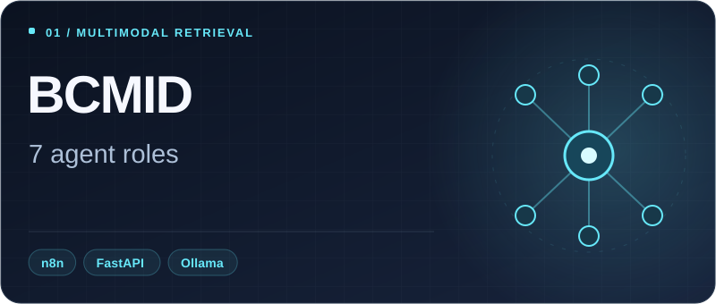
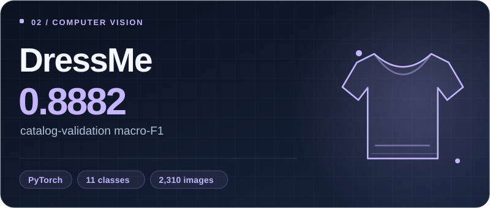
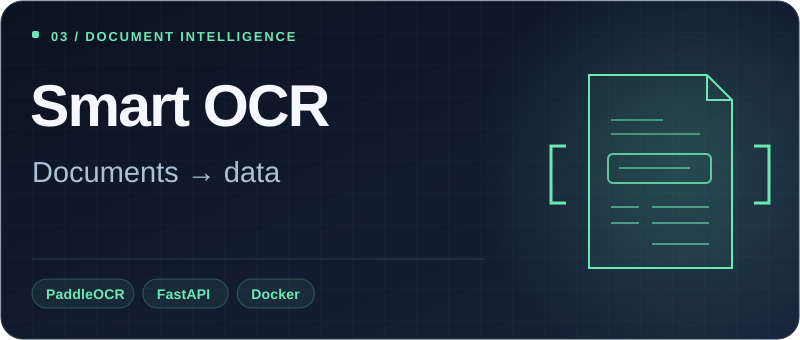
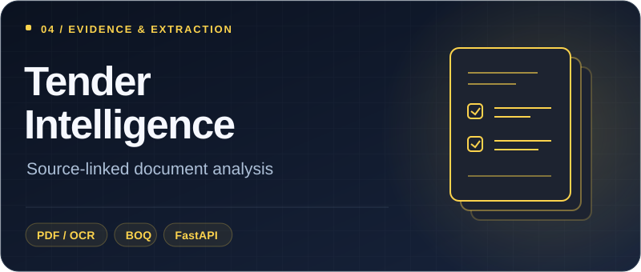
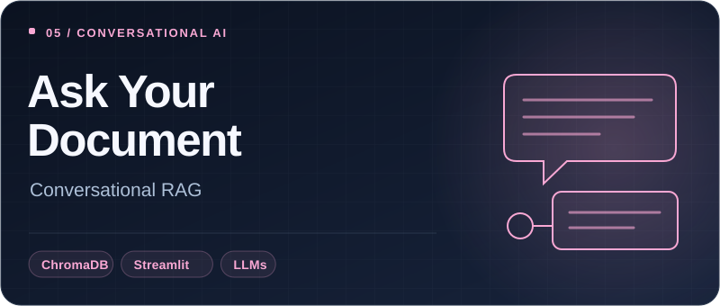
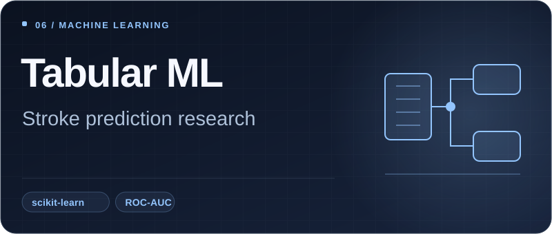
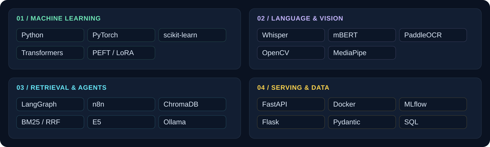

  

<strong>Computer Engineering · Data Science & AI · ESPRIT · Tunisia</strong>

  
  
  

I build **machine learning and deep learning applications** across language, vision and document intelligence. My work connects data preparation, model evaluation, retrieval and agent orchestration with APIs and Docker delivery.

## Selected work

  
  

  
  

  
  

DressMe: macro-F1 **0.8882** on **2,310 catalog validation images**. [Model card and evaluation scope](https://github.com/aymendhieb02/DressMe/blob/main/ml-service/bundle/model_card.md). BCMID and Stroke Prediction are research/educational prototypes.

<strong>Explore the methods, contributions and project status</strong>

| Project | What I worked on | Methods & status |
| --- | --- | --- |
| **[BCMID](https://github.com/aymendhieb02/bcmid)** | n8n-to-FastAPI workflows, Streamlit research interface, retrieval and data preparation within the group project | E5, BM25/RRF, ChromaDB, Ollama and seven agent roles. Research prototype with source citations and evidence checks. |
| **[DressMe](https://github.com/aymendhieb02/DressMe)** | BO6 wardrobe digitization and BO7 pretrained try-on experiments in the six-person team | EfficientNet-B0, transfer learning and reviewed attributes. The reported result is catalog validation; phone-photo performance is unmeasured. |
| **[Smart OCR-to-ERP](https://github.com/aymendhieb02/Smart-OCR-to-ERP-Platform)** | Independently built extraction pipelines and delivered client-specific Docker APIs | PaddleOCR, native PDF text, OpenCV, financial validation and FastAPI. The repository documents public-build and delivered-image boundaries. |
| **[Tender Intelligence](https://github.com/aymendhieb02/tender-document-intelligence)** | Independently built the core and continued validation with a client contact | PDF/OCR evidence, source-linked requirements, lexical Q&A and template-specific BOQ/pricing export. Client validation ongoing. |
| **[Ask Your Document](https://github.com/aymendhieb02/onyX)** | Built the document assistant as a hackathon product | Text chunking, embeddings, ChromaDB, LLMs, citations and MongoDB history. The current input is text documents. |
| **[Stroke Prediction](https://github.com/aymendhieb02/onyX_hackathon_mario_hack_Intelligent_Stroke_Prediction_System)** | Data/modeling workflow and application components within team OnyX | Missing-value treatment, feature engineering, model comparison and ROC-AUC evaluation. Competition prototype. |

[Detailed project notes](https://github.com/aymendhieb02/aymendhieb02/blob/main/docs/PROJECTS.md) cover individual contributions, validation context and remaining limitations. BCMID and Stroke Prediction are not clinically validated tools.

## Tools I use

  

<strong>Full technical stack</strong>

| Area | Technologies used in my projects |
| --- | --- |
| **ML & deep learning** | Python, PyTorch, scikit-learn, Transformers, PEFT/LoRA, XGBoost, CatBoost |
| **NLP, speech & vision** | Whisper, multilingual BERT, PaddleOCR, OpenCV, MediaPipe, VLM integration |
| **RAG & agents** | LangGraph, n8n, ChromaDB, E5 embeddings, BM25/RRF, Ollama |
| **Serving & MLOps** | FastAPI, Flask, Pydantic, Docker, MLflow, Git, Linux |
| **Data & applications** | SQL, PostgreSQL, MariaDB/MySQL, React, Angular, Spring Boot |

## Engineering in practice

- **Client delivery:** independently developed OCR APIs and handed over Docker images, adapting the solutions to each client's requirements.
- **ALIA CRM:** Project Manager and AI contributor in a six-person academic team with [Vital](https://vital.com.tn/), covering forecasting, sentiment analysis, multilingual speech transcription, document extraction and assistant orchestration.
- **[AI Exercise Form Analyzer](https://github.com/aymendhieb02/AI-Exercise-Form-Analyzer):** built a MediaPipe pose-analysis API for joint angles, repetition counting and form feedback; delivered a freelance client prototype.
- **[End-to-End MLOps Pipeline](https://github.com/aymendhieb02/End-to-End-MLOps-Pipeline):** university project connecting model training, MLflow tracking, FastAPI inference and Docker.

---

<strong>Data. Models. Useful systems.</strong> 
<a href="https://www.linkedin.com/in/aymendhieb/">LinkedIn</a> · <a href="mailto:aymen.dhieb@gmail.com">aymen.dhieb@gmail.com</a>

